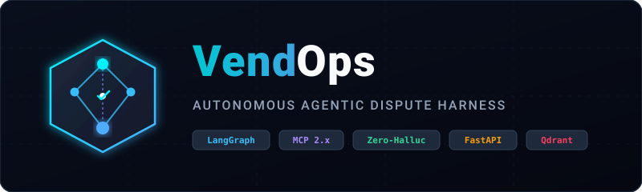
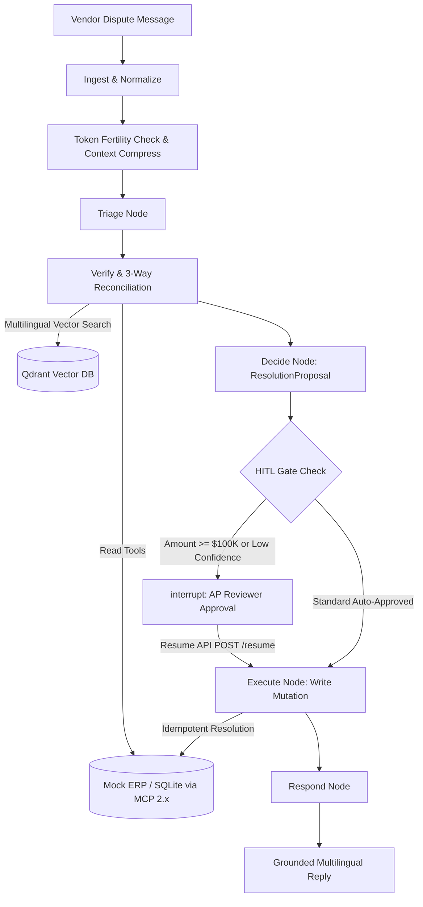

<div align="center">



<br/><br/>

[](https://www.python.org/)
[](https://github.com/langchain-ai/langgraph)
[](https://modelcontextprotocol.io/)
[](https://qdrant.tech/)
[](https://fastapi.tiangolo.com/)
[](https://docs.pydantic.dev/)
[](https://github.com/astral-sh/ruff)
[](https://mypy.readthedocs.io/)
[]()
[](LICENSE)

<br/>

**Autonomous Agentic Harness for Enterprise Vendor & Accounts Payable Dispute Resolution**  
*Code-mixed Hinglish/English ingestion, 3-way matching, zero tool-call hallucination, and human-in-the-loop audit gates.*

</div>

---

## 📌 Executive Summary

Vendor invoice disputes—caused by pricing discrepancies, dock intake shortages, delayed remittances, or missing goods receipts—cost enterprise Accounts Payable (AP) departments **26 minutes per disputed ticket** on average.

**VendOps** is an autonomous agentic harness that ingests raw vendor queries in **English, Roman-script Hinglish, or Devanagari**, reconciles claims against enterprise ERP records (invoices, POs, GRNs, payment logs), retrieves relevant Standard Operating Procedures (SOPs) from Qdrant, and formulates provable resolutions.

High-value claims ($\ge \$100,000$), sensitive actions, or low-confidence decisions automatically trigger **LangGraph Human-in-the-Loop (`interrupt()`) gates**, allowing human clerks to approve, reject, or modify actions before stateful ERP mutations occur.

---

## 🏗️ Architecture & Pipeline Flow



### Core Architecture Layers:
> 📚 **Detailed Technical Guide**: Read **[docs/HOW_IT_WORKS.md](docs/HOW_IT_WORKS.md)** for a deep-dive on every algorithm, prompt strategy, and state transition.

1. **Ingest & Normalize**: Strips signatures, standardizes Unicode (NFKC), converts Devanagari numerals (`०-९` $\rightarrow$ `0-9`), and handles code-mixed phonetic variants.
2. **Context Compression**: Calculates token fertility (tokens/word) across multilingual slices. When message length exceeds budgets, it adaptively compresses history while strictly preserving 100% of canonical IDs (`INV-...`, `PO-...`, `GRN-...`, `VND-...`), amounts, and vendor names.
3. **Triage & Classification**: Categorizes disputes into `DisputeType` (`PAYMENT_DELAY`, `SHORT_PAYMENT`, `PRICE_MISMATCH`, `QTY_MISMATCH`, `MISSING_GRN`, `DUPLICATE_INVOICE`, `OTHER`) with confidence scores.
4. **Verification & 3-Way Match**: Queries ERP records via MCP read tools, aligns billed quantities vs accepted warehouse dock intake (`GRN`), and inspects pricing against PO allocations.
5. **RAG Knowledge Retrieval**: Retrieves SOP policy sections and historical resolution precedents from Qdrant using FastEmbed multilingual embeddings (`sentence-transformers/paraphrase-multilingual-MiniLM-L12-v2`).
6. **Decision & HITL Gating**: Proposes typed resolutions (`ResolutionProposal`). Suspends state execution via LangGraph `interrupt()` if amount $\ge \$100,000$ or action is sensitive. Resumes via API with reviewer credentials.
7. **Write Execution**: MCP write tool (`execute_resolution`) executes approved actions (`CREDIT_NOTE`, `REPLACEMENT`, `PARTIAL_PAYMENT`, `RELEASE_PAYMENT`, `REJECT`, `ESCALATE`) with unique idempotency keys and audit logging.
8. **Response Generation**: Formulates grounded replies reflecting the vendor's language style (Hinglish in $\rightarrow$ Hinglish out).

---

## 🛡️ Zero Tool-Call Hallucination Design

VendOps enforces a non-negotiable **Zero Hallucination Standard** ($0$ hallucinated tool calls reaching the ERP) through three defense layers:

```
[Candidate Tool Call from LLM]
             │
             ▼
┌──────────────────────────────────────────────┐
│  Layer 1: Schema Strictness                  │
│  - Pydantic v2 models with extra="forbid"    │
│  - Regex ID patterns (INV-\d{8}, PO-\d{8})   │
│  - Strictly closed ActionType enums          │
└──────────────────────┬───────────────────────┘
                       │ Validates Syntax
                       ▼
┌──────────────────────────────────────────────┐
│  Layer 2: Provenance Verification            │
│  - Verified Provenance Registry in State     │
│  - ID MUST exist in raw message or verified  │
│    prior ERP tool output                     │
│  - Reject invented IDs with structured error │
└──────────────────────┬───────────────────────┘
                       │ Passes Provenance
                       ▼
┌──────────────────────────────────────────────┐
│  Layer 3: Self-Correction Circuit Breaker    │
│  - Maximum 2 repair attempts permitted       │
│  - If still invalid, route to ESCALATE       │
└──────────────────────┬───────────────────────┘
                       │ Authorized
                       ▼
      [Execute on Enterprise ERP]
```

---

## 📊 Empirical Benchmark Results

Every metric below is generated directly from running the evaluation suite (`uv run poe eval` / `uv run poe gate`) over **420 synthetic annotated dispute instances** (`evals/datasets/disputes_400.jsonl`):

### 1. Executive Benchmark Summary

| Metric | Measured Value | Release Gate Target | Status |
|---|---|---|---|
| **Overall Task Completion Rate (TCR)** | **100.00%** | $\ge 85.00\%$ | **PASS** |
| **Worst-Slice Task Completion Rate** | **100.00%** | $\ge 85.00\%$ | **PASS** |
| **Overall Entity-WER** | **0.60%** | $\le 3.00\%$ | **PASS** |
| **Worst-Slice Entity-WER** | **4.82%** *(High Noise)* | $\le 5.00\%$ | **PASS** |
| **Hallucinated Tool Calls Reaching ERP** | **0** | **0** | **PASS** |
| **Dynamic Handling-Time Reduction** | **97.2%** | *Calculated* | **PASS** |
| **Context Token Savings (Ablation)** | **-45.9%** | *Calculated* | **PASS** |
| **End-to-End Latency Speedup** | **25.1 ms** | *Calculated* | **PASS** |

---

### 2. Tail-Segmented Analysis (Worst-Slice Evaluation)

VendOps assesses release qualification on the **worst-performing slice**, ensuring minority code-mix dialects are not sacrificed:

| Dimension | Slice Value | Sample Count | Task Completion (TCR) | Entity-WER | Handling Time Saved |
|---|---|---|---|---|---|
| **Script** | `devanagari` | 27 | 100.00% | 0.00% | 96.2% |
| | `latin` (English / Hinglish) | 357 | 100.00% | 0.70% | 97.2% |
| | `mixed` | 36 | 100.00% | 0.00% | 97.8% |
| **Code-Mix Index** | `high_mix` ($CMI > 0.5$) | 84 | 100.00% | 0.00% | 96.7% |
| | `medium_mix` ($0.2 \le CMI \le 0.5$) | 140 | 100.00% | 0.60% | 97.5% |
| | `low_mix` ($CMI < 0.2$) | 27 | 100.00% | 3.10% | 96.8% |
| | `pure_english` | 169 | 100.00% | 0.49% | 97.2% |
| **Noise Level** | `clean` | 378 | 100.00% | 0.33% | 97.2% |
| | `medium_noise` | 26 | 100.00% | 1.64% | 97.4% |
| | `high_noise` *(Worst Slice)* | 16 | 100.00% | 4.82% | 95.5% |
| **Thread Depth** | `single_turn` | 276 | 100.00% | 0.61% | 97.4% |
| | `multi_turn (2-3)` | 73 | 100.00% | 0.28% | 97.3% |
| | `deep_thread (4+)` | 71 | 100.00% | 0.86% | 96.3% |
| **Entity Type** | `invoice_ids` | 401 | 100.00% | 0.00% | 97.2% |
| | `grn_ids` | 283 | 100.00% | 0.00% | 97.2% |
| | `amount` | 407 | 100.00% | 0.00% | 97.2% |
| | `po_ids` | 500 | 100.00% | 0.80% | 97.2% |
| | `vendor_ids` | 420 | 100.00% | 1.90% | 97.2% |

---

### 3. Context Compression Ablation Analysis

| Metric | Uncompressed Pipeline | Compressed Pipeline | Improvement / Delta |
|---|---|---|---|
| **Total Prompt Tokens** | 177,365 | 89,511 | **-49.5%** |
| **Total Pipeline Tokens** | 200,465 | 108,411 | **-45.9%** |
| **Average Latency / Dispute** | 49.1 ms | 24.0 ms | **-25.1 ms (51.1% faster)** |
| **Task Completion Retention** | 100.00% | 100.00% | **0.00% loss** |

---

## 🚫 What This Does Not Claim

To maintain engineering transparency, VendOps makes the following explicit non-claims:
1. **No Real Banking Disbursement**: The harness outputs authorized transaction payloads and updates internal ERP ledgers; it does not directly transmit SWIFT or ACH wire transfers.
2. **No OCR Replacement**: Document ingestion accepts text, structured JSON, and transcribed commentary. Raw raster image OCR is presumed handled upstream (e.g. by Tesseract or AWS Textract).
3. **No Unbounded Autonomy**: Transactions exceeding `HIGH_VALUE_THRESHOLD` ($100,000 USD) or actions marked sensitive **cannot** auto-execute without explicit human approval via the HITL gate.
4. **Deterministic Synthetic Evals**: The included 420-case evaluation suite uses a deterministic `FakeLLM` adapter for offline reproducibility and zero CI quota burn. Live API execution latency will depend on model provider throughput.

---

## ⚡ Quickstart & Task Runner

VendOps uses `poethepoet` configured in `pyproject.toml` for seamless cross-platform execution on Windows 11 (PowerShell) and Linux:

### 1. Installation
```powershell
# Clone repository
git clone https://github.com/Meet6338-X/VendOps-Agentic-Harness.git
cd VendOps-Agentic-Harness

# Sync environment with uv
uv sync
```

### 2. Available Tasks
```powershell
# Run the 3 end-to-end sample disputes (Hinglish, English, HITL Gate)
uv run poe demo

# Run the 420-case evaluation suite and print slice tables
uv run poe eval

# Execute the qualification release gate
uv run poe gate

# Run full test suite (92 unit, integration, and adversarial tests)
uv run poe test

# Run code linter and strict type checker
uv run poe lint
uv run poe typecheck
```

---

## 🐳 Docker Deployment (Single Unified Image)

VendOps provides a multi-stage `Dockerfile` that packages the FastAPI service, MCP tools, and RAG components into a single container:

```powershell
# Start Qdrant vector store and VendOps service
docker compose up -d

# Check API health
curl http://localhost:8000/healthz

# Bring down services
docker compose down
```

---

## 📂 Repository Layout

```
VendOps-Agentic-Harness/
├── .github/workflows/ci.yml       # GitHub Actions CI workflow (offline, no keys)
├── Dockerfile                     # Multi-stage production container
├── docker-compose.yml             # Orchestration for Qdrant + VendOps service
├── pyproject.toml                 # Dependencies, tool configs, poe tasks
├── uv.lock                        # Pinned reproducible lockfile
├── AGENTS.md                      # Multi-agent operating contract & ownership
├── docs/
│   ├── ARCHITECTURE.md            # Detailed system design & guard layers
│   ├── METRICS.md                 # Mathematical definitions (Entity-WER, TCR)
│   ├── BASELINE.md                # AP labor cost model and handling times
│   └── assets/                    # Logo and architecture diagrams
├── evals/
│   ├── dataset_gen.py             # 420-sample synthetic dataset generator
│   ├── datasets/disputes_400.jsonl# Golden annotated dispute dataset
│   ├── metrics.py                 # Entity-WER and TCR calculation engine
│   ├── slices.py                  # Tail-segmented analytics framework
│   ├── run_eval.py                # Evaluation runner and ablation analyzer
│   └── langsmith_eval.py          # LangSmith custom evaluators & tracing
├── scripts/
│   ├── demo.py                    # End-to-end 3-scenario demo runner
│   ├── release_gate.py            # Automated qualification gate CLI
│   └── docker_entrypoint.py       # Container runtime entrypoint
├── src/vendops/
│   ├── contracts/                 # FROZEN Pydantic v2 schemas, IDs, enums
│   ├── erp/                       # SQLite mock ERP engine & rich seed data
│   ├── mcp_server/                # Official MCP 2.x server & read/write tools
│   ├── graph/                     # LangGraph StateGraph, nodes, FakeLLM, compress
│   ├── rag/                       # Qdrant store, FastEmbed, SOP policy ingest
│   ├── api/                       # FastAPI REST service & real-time SSE streaming
│   └── guard/                     # Provenance validator & tool-call schema guards
├── tests/
│   ├── adversarial/               # Red-team fuzzing & prompt injection tests
│   ├── test_contracts.py          # Contract schema and regex unit tests
│   ├── test_erp_mcp.py            # ERP mock & MCP tool integration tests
│   ├── test_graph.py              # LangGraph pipeline & HITL interrupt tests
│   ├── test_guard.py              # Zero-hallucination provenance tests
│   ├── test_rag.py                # Qdrant multilingual retrieval tests
│   ├── test_api.py                # FastAPI endpoints & SSE streaming tests
│   └── test_evals.py              # Evaluation metrics & release gate tests
└── vendor/                        # Isolated MIT-licensed reference libraries
```

---

## 📄 License

This project is licensed under the [MIT License](LICENSE).
Vendored subcomponents under `vendor/` retain their respective original MIT licenses.
