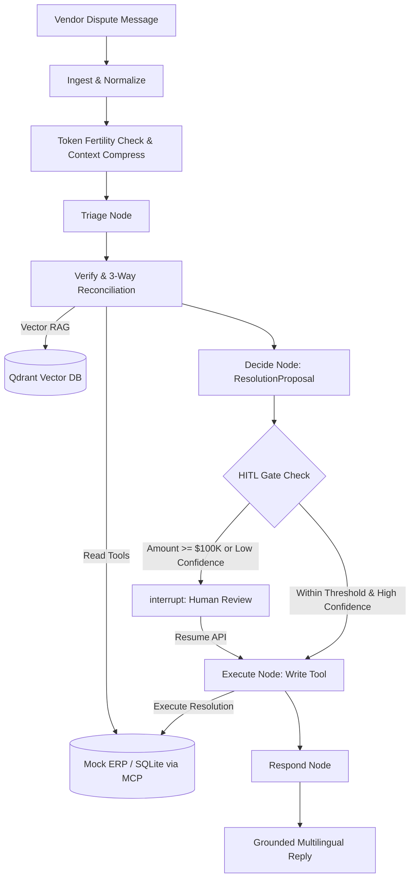

# Architecture & System Design: VendOps

VendOps is an autonomous agentic harness designed for enterprise accounts payable (AP) and vendor dispute resolution. It reconciles disputed claims against enterprise ERP data using LangGraph stateful orchestration, official Python Model Context Protocol (MCP 2.x), Qdrant vector retrieval, and human-in-the-loop (HITL) approval gates.

---

## 1. End-to-End Pipeline



---

## 2. Zero-Hallucination Guard Architecture

A fundamental requirement of VendOps is **0 hallucinated tool calls reaching the ERP**.

```
[LLM Candidate Tool Call]
          │
          ▼
┌──────────────────────────────────────────────┐
│       Layer 1: Schema Strictness             │
│  - Pydantic v2 with extra="forbid"           │
│  - Regex ID patterns (INV-\d{8}, PO-\d{8})   │
│  - Enum-only ActionType                      │
└──────────────────────┬───────────────────────┘
                       │ Validates Syntax
                       ▼
┌──────────────────────────────────────────────┐
│       Layer 2: Provenance Check              │
│  - Verified Provenance Registry in State     │
│  - Every ID must be proven in user query     │
│    or prior verified tool output             │
│  - Invented IDs rejected immediately         │
└──────────────────────┬───────────────────────┘
                       │ Passes Provenance
                       ▼
┌──────────────────────────────────────────────┐
│       Layer 3: Self-Correction Loop          │
│  - Max 2 repair attempts fed back to LLM     │
│  - If still invalid, route to ESCALATE       │
└──────────────────────┬───────────────────────┘
                       │ Authorized
                       ▼
[Execute Tool on Enterprise ERP Mock via MCP]
```

---

## 3. Human-in-the-Loop (HITL) Mechanism

VendOps leverages LangGraph's native `interrupt()` and `Command(resume=...)` pattern:

1. **Gate Triggers**:
   - `amount >= HIGH_VALUE_THRESHOLD` (Default: $100,000 USD)
   - `proposal.confidence < 0.85`
   - Sensitive action types (`RELEASE_PAYMENT` on disputed POs or high-variance claims)
2. **Interrupt**:
   - The graph suspends state execution at `hitl_gate` node.
   - The pending `ResolutionProposal` and evidence trail are surfaced to the AP reviewer.
3. **Resumption**:
   - The AP clerk reviews via the API (`POST /api/v1/disputes/{thread_id}/resume`).
   - The graph resumes with `Command(resume={"approved": True/False, "reviewer_id": "...", "comments": "..."})`.
   - On approval, execution proceeds to `execute` node; on rejection, it routes to `REJECT` or manual AP ticket queue.
